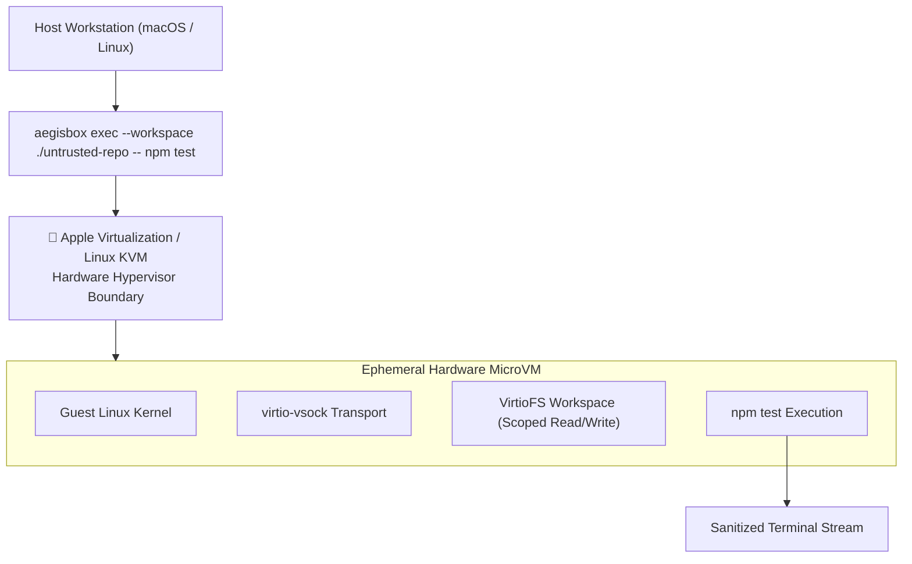

# Recipe: Untrusted Repository Detonation

> **Use Case ID:** `AEG-UC-01`  
> **Target Audience:** Developers, Security Researchers, AI Agent Operators  
> **Platform Engine:** Hardware Virtualization (macOS Virtualization.framework / Linux KVM)  

---

## 1. Problem Statement

Developers frequently need to clone, inspect, and build third-party open-source repositories or pull requests from untrusted contributors. Even running simple commands like `npm test` or `make` can trigger malicious Makefile targets, CGO compiler exploits, or obfuscated post-clone scripts that compromise developer workstations.

---

## 2. When to Use This

Use **Untrusted Repository Detonation** whenever an AI agent or developer is instructed to evaluate an unknown GitHub repository. Aegisbox spins up an ephemeral microVM in under 100ms with a dedicated kernel, isolated memory space, and virtualized block devices.

---

## 3. Architecture & Dataflow



---

## 4. Prerequisites

1. **Aegisbox Installed:** `brew install bonjoski/tap/aegisbox`.
2. **Hardware Virtualization Enabled:** Apple Silicon / Intel with VMX/SVM support.
3. **Aegisbox Daemon Active:** `aegisbox daemon start`.

---

## 5. Step-by-Step Recipe

### Step 1: Clone Untrusted Repository into an Isolated Directory
```bash
git clone https://github.com/suspicious-user/unvetted-tool.git ./untrusted-repo
```

### Step 2: Detonate and Build Inside Aegisbox MicroVM
```bash
# Execute npm build inside the microVM hardware sandbox
aegisbox exec --workspace ./untrusted-repo -- npm install

# Run the test suite
aegisbox exec --workspace ./untrusted-repo -- npm test
```

### Step 3: Run Interactive Shell in the MicroVM
To explore the repo interactively from inside the VM:
```bash
aegisbox exec --workspace ./untrusted-repo --interactive -- /bin/bash
```

---

## 6. Verification & Expected Output

Verify that the microVM kernel is distinct from host kernel:
```bash
aegisbox exec -- uname -a
```
Expected output:
```text
[aegisbox] Spawning ephemeral microVM (libkrun / Virtualization.framework)...
Linux aegisbox-guest 6.6.21-aegisbox #1 SMP PREEMPT arm64 GNU/Linux
[aegisbox] VM terminated. Teardown time: 24ms.
```

---

## 7. Security Invariants & Blast Radius

- **Hardware Memory Isolation:** Guest code runs in isolated guest physical address space. Even kernel panics or zero-day kernel exploits inside the microVM cannot access host RAM.
- **Network Egress Containment:** MicroVM network traffic is routed through a virtual TAP adapter with strict host firewall rules (`pfctl` / `nftables`).
- **No Access to Host Secrets:** `~/.ssh`, `~/.aws`, and host environment variables are never mounted into the microVM.

---

## 8. Troubleshooting & Common Pitfalls

- **Issue:** `aegisbox exec` fails with `failed to initialize virtualization framework`.  
  **Remediation:** Verify that your terminal or editor has virtualization entitlements (`com.apple.security.virtualization`). Run `aegisbox doctor` for automated diagnosis.
