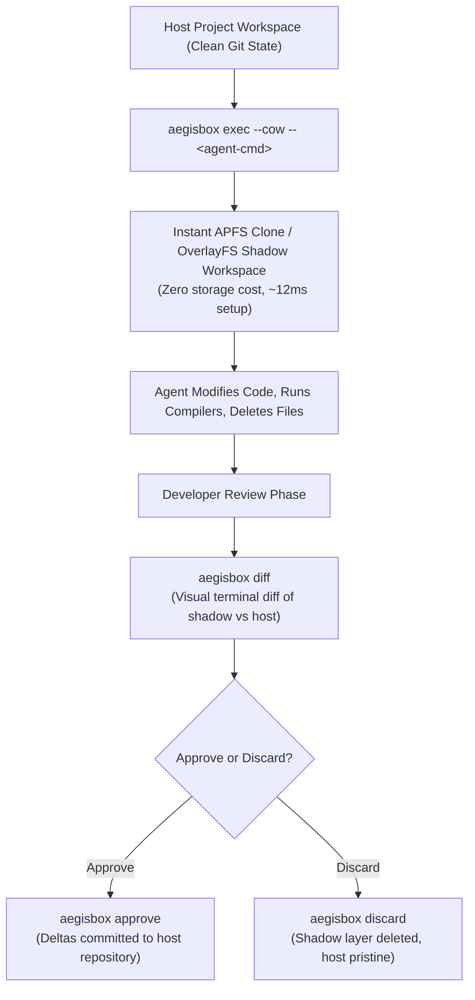

# Recipe: Copy-on-Write (COW) Shadow Workspaces

> **Use Case ID:** `AEG-UC-02`  
> **Target Audience:** AI Coding Agent Operators, Developers Reviewing Agent Refactors  
> **Platform Engine:** APFS Clonefile / OverlayFS & Git Diff Integration  

---

## 1. Problem Statement

Autonomous agents frequently produce hallucinated edits, delete necessary configuration files, or generate hundreds of spurious build artifacts across a clean git repository. Reverting messy agent modifications is time-consuming and risks losing legitimate work.

---

## 2. When to Use This

Use **Copy-on-Write (COW) Shadow Workspaces** whenever you delegate complex refactoring or exploratory tasks to an AI agent. Aegisbox creates an instant, zero-cost block-level clone of your repository. The agent executes inside the shadow copy; all writes, compiles, and deletes happen on the shadow layer. You then inspect the diff and either **approve** or **discard** the changes with one command.

---

## 3. Architecture & Dataflow



---

## 4. Prerequisites

1. **Aegisbox:** Version 1.0+ on `$PATH`.
2. **Filesystem:** APFS (macOS) or OverlayFS / Btrfs / ZFS (Linux).

---

## 5. Step-by-Step Recipe

### Step 1: Run Agent in a Shadow Workspace
```bash
# Execute agent refactor in an isolated COW shadow workspace
aegisbox exec --cow -- npm run refactor
```

### Step 2: Inspect Changes with `aegisbox diff`
```bash
aegisbox diff
```
Expected output:
```text
📝 Aegisbox Shadow Workspace Delta Summary:
   • Modified: src/index.ts (+24 lines, -8 lines)
   • Created:  src/utils/sanitize.ts (+45 lines)
   • Deleted:  src/legacy.ts (-112 lines)
   • Spurious: node_modules/.cache/ (Ignored)

Review full git diff? (y/n): y
[Diff viewer displays colored unified diff...]
```

### Step 3: Approve or Discard Changes
```bash
# If changes are satisfactory, commit to host:
aegisbox approve

# Or if the agent went off track, discard cleanly:
aegisbox discard
```

---

## 6. Verification & Expected Output

After running `aegisbox discard`, verify that your host repository remains pristine:
```bash
git status
```
Output confirms: `nothing to commit, working tree clean`.

---

## 7. Security Invariants & Blast Radius

- **Host Immutability During Execution:** The host directory is mounted read-only to the microVM. It is impossible for the agent to alter host files directly.
- **Selective Delta Merging:** The approval engine filters out build caches (`node_modules`, `.cache`, `target/`) to ensure only reviewed source files are merged.

---

## 8. Troubleshooting & Common Pitfalls

- **Issue:** `aegisbox diff` reports `no active shadow workspace found`.  
  **Remediation:** The shadow workspace was already approved or discarded. Use `--keep-shadow` if you need to retain shadow state across multiple runs.
