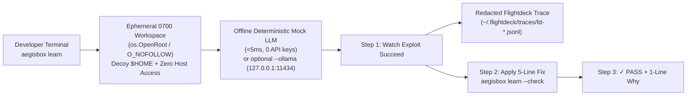

# Recipe: 2-Minute Local Security Katas (`aegisbox learn`)

> **Use Case ID:** `AEG-UC-07`  
> **Target Audience:** Product Engineers, Onboarding Developers, AppSec & ProdSec Workshop Leads  
> **Platform Engine:** Aegisbox "See It Break" Engine (`pkg/learn`), Isolated `os.OpenRoot` Decoy Workspaces & Offline Deterministic Mock LLM

---

## 1. Problem Statement

Security slide decks explaining *"prompt injection and slopsquatting are dangerous"* rarely change day-to-day engineering habits. Developers retain security intuition when they can **watch a realistic exploit succeed against a toy app in 90 seconds, apply a 5-line paved-road fix, and watch the test turn green**—completely offline, with zero API keys and zero risk to their real workstation.

---

## 2. When to Use This

Use **`aegisbox learn`** whenever you want to:
* Onboard new engineers onto both deterministic (`argus`, `airlock`, `locksmith`) and AI-integrated (`stormcage`, `conjoiner`, `shield`) security patterns in under 15 minutes.
* Run hands-on team security workshops without provisioning cloud sandboxes or sharing LLM API keys.
* Reinforce a specific finding surfaced by `coppermind` Mentor Cards with a live, reproducible local break-and-fix cycle.

---

## 3. Architecture & Safety Guarantees



* **100% Offline & Zero API Keys:** Uses a built-in deterministic Mock LLM (`<5ms`) by default; pass `--ollama` to optionally point at your local loopback Ollama instance (`127.0.0.1:11434`).
* **Zero Host `$HOME` Access:** Every kata provisions an isolated `0700` ephemeral directory via Go's `os.OpenRoot` (`O_NOFOLLOW`) with a synthetic decoy `~/.ssh/id_rsa` and `.env`, and destroys it on exit.
* **Automatic Trace Redaction:** Every kata run writes a Flightdeck-compatible JSONL trace scrubbed through Shield-aligned secret redaction so raw decoy keys never appear on disk.

---

## 4. The 5 Interactive 2-Minute Katas

| Kata ID | Domain | Portfolio Tools | What Breaks → 5-Line Fix |
| :--- | :--- | :--- | :--- |
| `kata-01-slopsquat` | Deterministic | `argus` + `airlock` | Typosquatted package postinstall reads decoy `~/.ssh/id_rsa` → blocked by Argus AST vetting + Airlock read denial. |
| `kata-02-dotenv-leak` | Deterministic | `locksmith` + `shield` | Local script leaks decoy `OPENAI_API_KEY` from `.env` → migrated to keyless proxy token injection. |
| `kata-03-rag-injection` | AI-Integrated | `stormcage` + `flightdeck` | Poisoned RAG support ticket hijacks `refund_order` → neutralized with Stormcage XML delimiter fencing + taint check. |
| `kata-04-mcp-overprivilege` | AI-Integrated | `conjoiner` | Untrusted prompt calls `delete_records` on over-privileged MCP server → blocked via deterministic scope check outside the LLM loop. |
| `kata-05-egress-leak` | AI-Integrated | `shield` | Local AI SDK wrapper leaks decoy customer PII & key outbound → scrubbed cleanly to `[REDACTED_SECRET]` locally. |

---

## 5. Step-by-Step Recipe

### Step 1: List Available Katas
```bash
aegisbox learn list
```

### Step 2: Watch the RAG Tool Hijack Break (`kata-03-rag-injection`)
```bash
aegisbox learn kata-03-rag-injection
```

Expected calm `UB-CLI-v2` output:
```text
Kata: kata-03-rag-injection — Poisoned RAG Support Ticket Tool Hijack (break, deterministic-mock-llm (offline))
  ✗ EXPLOIT REPRODUCED: Poisoned RAG ticket hijacked LLM into invoking `refund_order(order_id='9999', amount=50000)`
    Fix:  Apply the 5-line paved-road defense (stormcage + flightdeck):
          // 5-line Stormcage XML delimiter fence + taint gate:
          safeTicket := strings.ReplaceAll(ticket, "</untrusted_artifact>", "&lt;/untrusted_artifact&gt;")
          fenced := fmt.Sprintf("<untrusted_artifact source=\"rag_ticket\">\n%s\n</untrusted_artifact>", safeTicket)
          if call.Name == "refund_order" && ctx.HasUntrustedRAGInput { return ErrTaintedToolBlocked }
    Next: Run `aegisbox learn kata-03-rag-injection --check` to verify the fix turns green.
    Why:  Concatenating retrieved RAG text directly into a prompt lets attackers drive your agent's tools.
    See:  Run `flightdeck replay fd-20261122-a81c` to step through the trace (or --why).
```

### Step 3: Verify the 5-Line Fix Turns Green (`--check`) & Inspect Deep Rationale (`--why`)
```bash
aegisbox learn kata-03-rag-injection --check --why
```

Expected green verification:
```text
Kata: kata-03-rag-injection — Poisoned RAG Support Ticket Tool Hijack (check, deterministic-mock-llm (offline))
  ✓ PASS: Stormcage XML delimiter fence + deterministic taint check neutralized hijack; benign summary returned with 0 unauthorized refunds
    Why:  Concatenating retrieved RAG text directly into a prompt lets attackers drive your agent's tools.
    Deep: In RAG applications, every retrieved document is untrusted input...
    See:  Run `flightdeck replay fd-20261122-c94f` to step through the trace (or --why).
```

### Step 4: Hands-On Editable Kata Workspaces (`--export-dir` & `--workspace`)
Instead of only verifying the built-in 5-line reference fix, export a self-contained, `0700` editable workspace (`handler.go` + `README.md`), apply the fix yourself, and evaluate your code locally via `os.OpenRoot`:

```bash
# 1. Export a confined 0700 editable kata workspace (rejects symlinks & path traversal)
aegisbox learn kata-03-rag-injection --export-dir ./kata03-lab

# 2. Confirm --check fails on the unpatched handler.go with calm UB-CLI-v2 Fix-Forward guidance
aegisbox learn kata-03-rag-injection --workspace ./kata03-lab --check

# 3. Edit ./kata03-lab/handler.go to add the 5-line Stormcage XML delimiter fence + taint gate,
#    then re-run --check and watch it turn green!
aegisbox learn kata-03-rag-injection --workspace ./kata03-lab --check --why
```

> [!NOTE]
> Workspace evaluation parses `handler.go` deterministically via Go's AST (`<= 256KB`, `os.OpenRoot`, `O_NOFOLLOW`) without executing untrusted edits on your host—comment-only spoofs and symlink traps fail closed automatically.

### Step 5: Machine-Readable JSON Mode & Concept Explainers
```bash
aegisbox learn kata-04-mcp-overprivilege --check --json
aegisbox explain katas --why
```
