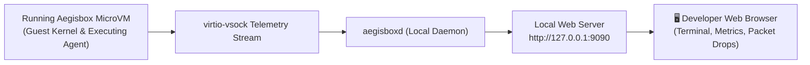

# Recipe: Interactive Visual Cockpit UI for MicroVM Inspection

> **Use Case ID:** `AEG-UC-03`  
> **Target Audience:** Developers, Security Analysts, Visual Debuggers  
> **Platform Engine:** Web Cockpit Dashboard & WebSocket Terminal Streaming  

---

## 1. Problem Statement

Running complex multi-step build scripts or autonomous agents in headless terminal sandboxes makes it difficult to observe real-time resource exhaustion (CPU spikes, memory thrashing), network packet drops, or stuck child processes.

---

## 2. When to Use This

Use the **Aegisbox Cockpit UI** when you want visual, interactive observability into running microVMs:
- Live terminal streaming with input injection.
- Real-time CPU, RAM, and disk I/O metrics.
- Network traffic log showing allowed vs dropped connection attempts.
- Interactive shadow workspace diff viewer.

---

## 3. Architecture & Dataflow



---

## 4. Prerequisites

1. **Aegisbox CLI:** Available on `$PATH`.
2. **Modern Web Browser:** Chrome, Safari, Firefox.

---

## 5. Step-by-Step Recipe

### Step 1: Launch Cockpit UI
```bash
# Launch Cockpit attached on default port 9090
aegisbox cockpit

# Or launch on custom port and open browser automatically
aegisbox cockpit --port 8088 --open
```

### Step 2: Open Dashboard in Browser
Navigate to `http://127.0.0.1:9090`. The dashboard displays:
- **Active MicroVMs:** Current running instances and their allocated CPU/RAM.
- **Console Tab:** Real-time WebSocket terminal output from the guest VM.
- **Firewall Tab:** Real-time log of blocked egress connection attempts.
- **Deltas Tab:** Visual diff viewer for pending shadow workspace modifications.

---

## 6. Verification & Expected Output

Run a sandboxed command in another terminal:
```bash
aegisbox exec -- curl -s https://untrusted-site.com
```
In the Cockpit UI Firewall tab, verify that an alert immediately appears:
> `[BLOCKED] Outbound TCP handshake to 198.51.100.24:443 dropped by host TAP firewall rule.`

---

## 7. Security Invariants & Blast Radius

- **Loopback Binding Only:** The Cockpit HTTP server binds strictly to `127.0.0.1`. It never listens on public or LAN interfaces.
- **CSRF & Origin Protection:** WebSocket connections require local session tokens generated at startup to prevent browser-based cross-origin hijacking.

---

## 8. Troubleshooting & Common Pitfalls

- **Issue:** Port 9090 is already occupied.  
  **Remediation:** Specify an alternate port:
  ```bash
  aegisbox cockpit --port 9095
  ```
