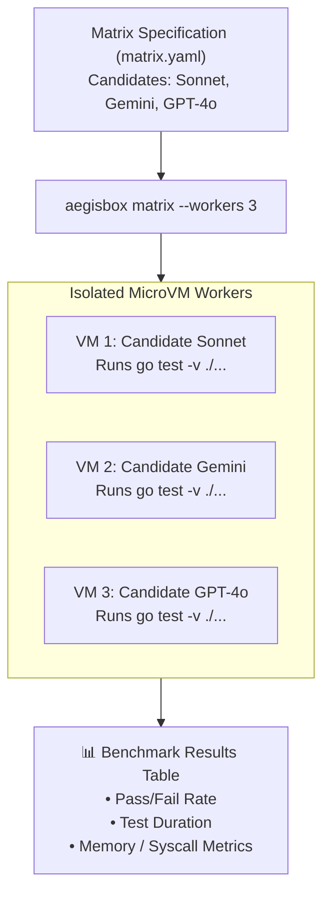

# Recipe: Multi-Agent Matrix Benchmarking

> **Use Case ID:** `AEG-UC-04`  
> **Target Audience:** Prompt Engineers, Model Evaluators, AI Systems Researchers  
> **Platform Engine:** Concurrent MicroVM Worker Pool  

---

## 1. Problem Statement

When comparing model capabilities or testing different system prompts (e.g. comparing Claude 3.5 Sonnet vs. Gemini 2.0 vs. DeepSeek on an identical bug-fix task), running evaluations sequentially on the host machine is slow and causes state contamination: one candidate agent's build artifacts or failed dependencies can pollute subsequent runs.

---

## 2. When to Use This

Use **Aegisbox Matrix Benchmarking** to evaluate $N$ candidate refactors or model outputs concurrently. Aegisbox spawns an ephemeral microVM worker for each test candidate, runs the build and test suites in parallel with identical baseline code, and outputs a structured benchmark comparison table.

---

## 3. Architecture & Dataflow



---

## 4. Prerequisites

1. **Aegisbox:** Version 1.0+ with daemon active.
2. **Matrix Config:** `matrix.yaml` defining candidates and verification commands.

---

## 5. Step-by-Step Recipe

### Step 1: Create `matrix.yaml`
```yaml
schema_version: "1.0"
benchmark_name: "auth-refactor-eval"
baseline_workspace: "."

command: "go test -v ./pkg/auth/..."
timeout: "120s"

candidates:
  - id: "candidate-a"
    patch: "./evals/patch-a.diff"
  - id: "candidate-b"
    patch: "./evals/patch-b.diff"
  - id: "candidate-c"
    patch: "./evals/patch-c.diff"
```

### Step 2: Run Matrix Evaluation
```bash
aegisbox matrix --config matrix.yaml --workers 3
```

---

## 6. Verification & Expected Output

Expected terminal summary:
```text
📊 Aegisbox Matrix Evaluation Results
─────────────────────────────────────────────────────────────────────────────
Candidate     Status   Duration   Tests Passed   Memory Peak   Exit Code
─────────────────────────────────────────────────────────────────────────────
candidate-a   PASSED   1.84s      14/14          42 MB         0
candidate-b   FAILED   0.92s      8/14           38 MB         1
candidate-c   PASSED   2.10s      14/14          45 MB         0
─────────────────────────────────────────────────────────────────────────────
Summary: 2 passed, 1 failed. Output saved to ./evals/matrix-report.json.
```

---

## 7. Security Invariants & Blast Radius

- **Total Worker Isolation:** Worker microVMs cannot see each other's memory or network interfaces.
- **Automatic Resource Capping:** Each worker VM is pinned to allocated CPU and memory ceilings (e.g. 2 cores, 1GB RAM) to prevent benchmark starvation.

---

## 8. Troubleshooting & Common Pitfalls

- **Issue:** Host machine runs out of memory when spawning 8 workers.  
  **Remediation:** Lower the concurrency flag:
  ```bash
  aegisbox matrix --workers 2
  ```
