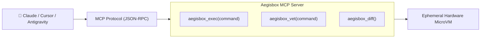

# Recipe: Model Context Protocol (MCP) MicroVM Server

> **Use Case ID:** `AEG-UC-05`  
> **Target Audience:** Claude Desktop, Cursor, and Antigravity Agent Developers  
> **Platform Engine:** Model Context Protocol & libkrun Hardware MicroVM  

---

## 1. Problem Statement

Autonomous agents with native terminal tools can execute destructive commands (`rm -rf`, `git reset --hard`, `sudo`). Giving an agent raw shell tool access risks irrecoverable system corruption or data loss.

---

## 2. When to Use This

Use **Aegisbox MCP Server** to give an AI coding agent full freedom to run shell commands, install tools, and execute scripts, but direct every single tool invocation into an ephemeral hardware microVM. The agent interacts with tools like `aegisbox_exec`, `aegisbox_vet`, and `aegisbox_diff` without needing to understand hypervisors or host security boundaries.

---

## 3. Architecture & Dataflow



---

## 4. Prerequisites

1. **Aegisbox:** Version 1.0+ on `$PATH`.
2. **AI Client:** Claude Desktop, Cursor, or Antigravity IDE.

---

## 5. Step-by-Step Recipe

### Step 1: Configure MCP Server
In `~/Library/Application Support/Claude/claude_desktop_config.json` or `.cursor/mcp.json`:
```json
{
  "mcpServers": {
    "aegisbox": {
      "command": "aegisbox",
      "args": ["mcp"]
    }
  }
}
```

### Step 2: Use in Agent Prompts
Prompt the assistant:
> *"Please build the project and execute all unit tests using the Aegisbox sandbox."*

The assistant automatically calls `aegisbox_exec(command="npm test")`. Execution occurs inside the microVM and returns sanitized stdout to the model.

---

## 6. Verification & Expected Output

Verify MCP server responsiveness via CLI:
```bash
echo '{"jsonrpc":"2.0","id":1,"method":"tools/list"}' | aegisbox mcp
```
Returns list of available tools: `aegisbox_exec`, `aegisbox_vet`, `aegisbox_diff`, `aegisbox_matrix`.

---

## 7. Security Invariants & Blast Radius

- **Strict Tool Scoping:** The agent cannot break out of the microVM because all command execution happens behind the `libkrun` / hypervisor boundary.
- **PTY Sanitization:** Blocks terminal input injection attacks (`TIOCSTI`).

---

## 8. Troubleshooting & Common Pitfalls

- **Issue:** Client reports timeout during long builds.  
  **Remediation:** Pass timeout parameter in tool arguments: `aegisbox_exec(command="cargo build", timeout=300)`.
