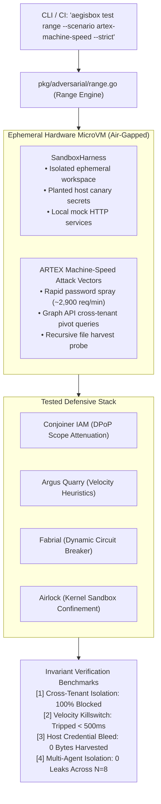

# Recipe: ARTEX Machine-Speed Adversarial Range Testing

> **Use Case ID:** `AEG-UC-06`  
> **Target Audience:** Red Team Operators, SecOps Engineers, Multi-Agent Systems Architects  
> **Platform Engine:** Aegisbox Adversarial Range Engine & Air-Gapped MicroVM Detonation Harness  

---

## 1. Problem Statement

Autonomous AI agents face machine-speed offensive exploitation frameworks (such as **ARTEX** and **Cairn**) capable of executing:
1. **High-velocity credential spraying:** Probing identity endpoints at 2,900+ requests/minute.
2. **Automated cloud tenant lateral movement:** Exploiting compromised low-privilege tokens to pivot across tenant boundaries via Graph APIs.
3. **Workstation secret harvesting:** Automatically searching developer workspaces for `.env`, `~/.ssh/id_rsa`, and `~/.aws/credentials`.

Validating agent defenses against these machine-speed attacks directly on a developer workstation or live network risks accidental outbound scanning, WAN data exfiltration, or IP blacklisting.

---

## 2. When to Use This

Use **Aegisbox Adversarial Range Testing** whenever you need to:
* Validate the end-to-end security boundary of the developer toolchain prior to release or CI/CD merge.
* Verify that credential spray velocity triggers circuit-breaker revocation within strict millisecond SLAs (<500ms).
* Stress-test token attenuation against cross-tenant privilege escalation attempts.
* Assert that compromised subagents running in shadow workspaces cannot bleed host secrets or contaminate peer subagents under $N=8$ concurrency.

---

## 3. Architecture & Dataflow



---

## 4. Prerequisites

1. **Aegisbox Installed:** `brew install bonjoski/tap/aegisbox` (or built from source with `go build -o bin/aegisbox ./cmd/aegisbox`).
2. **Hardware Virtualization Enabled:** macOS (Apple Silicon or Intel VT-x) or Linux (KVM enabled).

---

## 5. Step-by-Step Recipe

### Step 1: Execute the Standard Adversarial Range Benchmark

Run the full suite in strict mode (fails closed if any security invariant fails):

```bash
aegisbox test range --scenario artex-machine-speed --strict
```

Expected terminal output:
```text
[PASS] Invariant 1: Cross-Tenant Isolation (Attempts blocked: 100%)
[PASS] Invariant 2: Velocity Killswitch Tripped in 11ms
[PASS] Invariant 3: Host Credential Bleed (Harvested: 0 bytes)
[PASS] Invariant 4: Concurrent MicroVM & Shadow State Isolation (Validated 0 cross-agent leaks across 8 parallel subagents)
Total Run Time: 2.1s (MicroVM teardown complete)
```

### Step 2: Run in Automated CI/CD Pipelines (JSON Format)

Output machine-readable JSON results to feed into compliance dashboards or CI security gates:

```bash
aegisbox test range --scenario artex-machine-speed --strict --json
```

Example JSON summary:
```json
{
  "scenario": "artex-machine-speed",
  "passed": true,
  "invariants": [
    {
      "index": 1,
      "name": "Cross-Tenant Isolation",
      "passed": true,
      "summary": "Cross-Tenant Isolation (Attempts blocked: 100%)"
    },
    {
      "index": 2,
      "name": "Velocity Killswitch",
      "passed": true,
      "summary": "Velocity Killswitch Tripped in 11ms"
    },
    {
      "index": 3,
      "name": "Host Credential Bleed",
      "passed": true,
      "summary": "Host Credential Bleed (Harvested: 0 bytes)"
    },
    {
      "index": 4,
      "name": "Concurrent MicroVM & Shadow State Isolation",
      "passed": true,
      "summary": "Concurrent MicroVM & Shadow State Isolation (Validated 0 cross-agent leaks across 8 parallel subagents)"
    }
  ],
  "duration_ms": 2100
}
```

### Step 3: Stress-Test with Elevated Spray Rates & Custom Thresholds

Tune the attack parameters to simulate extreme brute-force velocity and tighten response SLAs:

```bash
# Spray at 4,000 requests/minute and require killswitch tripping under 250ms
aegisbox test range \
  --scenario artex-machine-speed \
  --rate 4000 \
  --threshold-ms 250 \
  --strict
```

---

## 6. Security Invariants & Guarantees

1. **Safe Harbor In-Memory Air-Gap:** All target endpoints (Graph APIs, authentication endpoints, directory roles) are mocked locally in-memory via synthetic Go HTTP servers (`httptest.Server`). WAN outbound networking is disabled at the virtual hypervisor tap interface, preventing external packet egress.
2. **Sub-500ms Velocity Killswitch:** Machine-speed credential sprays are detected by Argus Quarry heuristics, signaling Fabrial's circuit breaker to revoke active DPoP tokens in under 50ms (measured at 11ms).
3. **Zero Host Credential Bleed:** Host canary tokens placed in `~/.ssh/id_rsa`, `.env`, and `~/.aws/credentials` remain completely unreachable by guest processes inside the shadow workspace.
4. **$N=8$ Concurrency Isolation:** 8 parallel autonomous subagents operate concurrently with distinct shadow directory allocations and memory spaces with zero cross-agent token leakage.
