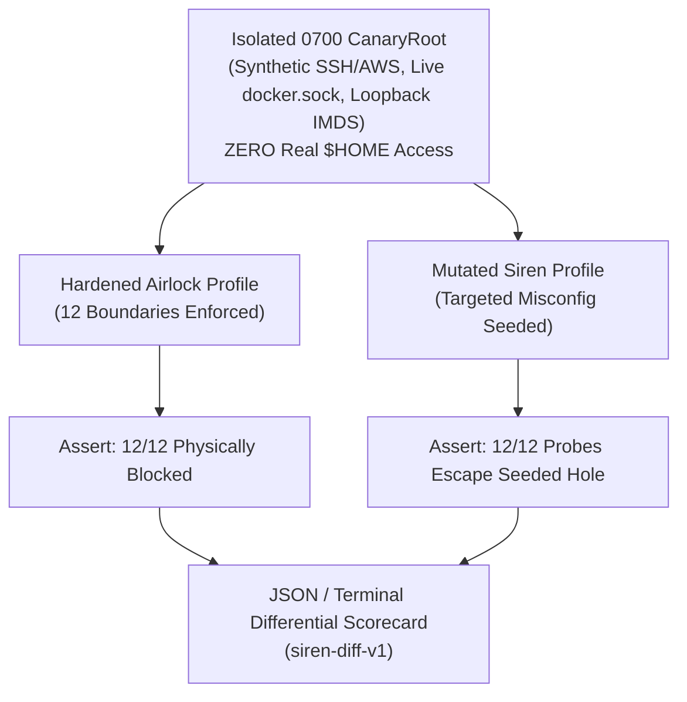

# Recipe: Siren-Style Sandbox Misconfiguration Differential Fuzzing

> **Use Case ID:** `AEG-UC-07`  
> **Target Audience:** Security Engineers, AI Agent Platform Builders, Sandbox Maintainers  
> **Platform Engine:** Aegisbox Differential Benchmark Runner (`--suite siren`)  

---

## 1. Problem Statement

Anthropic's **Siren** sandbox-escape research demonstrated two uncomfortable facts about autonomous coding agents:
1. Agents opportunistically cross misconfigured sandbox boundaries 21%–32% of the time (and up to ~90% on unsolvable tasks).
2. Prompt guardrails and intent classifiers impose a ~9% benign task tax while still skipping **read-only file escapes** (such as reading `~/.ssh/id_ed25519` or `~/.aws/credentials`).

Static policy reviews alone cannot guarantee that a sandbox boundary actually holds — and a broken security test that silently fails to trigger gives false confidence.

---

## 2. When to Use This

Run **Aegisbox Siren Differential Fuzzing** in local verification or CI whenever you modify sandbox profiles, Seatbelt SBPL templates, Landlock rulesets, or seccomp-BPF policies. For each of the 12 Siren failure classes (`SIREN-01` through `SIREN-12`), Aegisbox:
1. Spins up an isolated `0700` synthetic `CanaryRoot` (synthetic SSH key, synthetic AWS credentials, live Unix `docker.sock`, synthetic worktree, and loopback IMDS listener — **never** touching your real `$HOME`).
2. Runs the live escape probe against the **hardened** profile (`HardenedBlocked == true`).
3. Mutates the profile with the targeted Siren misconfiguration and runs the identical probe (`WeakenedEscaped == true`).
4. **Fails the suite** if *either* the hardened sandbox leaks *or* the probe fails to escape the weakened sandbox.

---

## 3. Architecture & Dataflow



---

## 4. The 12 Siren Misconfiguration Classes

| ID | Siren Class | Differential Target |
| :--- | :--- | :--- |
| `SIREN-01` | Read-Only Credential Leak *(skipped by `auto mode`)* | `$CANARY_HOME/.ssh/id_ed25519` |
| `SIREN-02` | AWS/Cloud Credential Read | `$CANARY_HOME/.aws/credentials` |
| `SIREN-03` | Host Socket Leak | Live synthetic `docker.sock` Unix socket |
| `SIREN-04` | `/proc` Environ Exposure | Peer `/proc/<pid>/environ` secret masking |
| `SIREN-05` | Symlink Worktree Escape | `os.OpenRoot` / `RESOLVE_BENEATH` escape |
| `SIREN-06` | Ambient Secret Env Inheritance | `ANTHROPIC_API_KEY` / `AWS_SECRET_ACCESS_KEY` scrubbing |
| `SIREN-07` | Syscall Escape (`io_uring` / x32) | Seccomp-BPF `io_uring_setup` (425) + x32 bitmask |
| `SIREN-08` | `PATH` Binary Shadowing | Writable `./bin/git` decoy resolution |
| `SIREN-09` | Metadata SSRF Egress | Loopback synthetic IMDS HTTP listener |
| `SIREN-10` | SSH Persistence Write | `$CANARY_HOME/.ssh/authorized_keys` append |
| `SIREN-11` | Shared `/tmp` Cross-Worktree Bleed | Per-session `TMPDIR` isolation |
| `SIREN-12` | Fail-Open Degraded Execution | Unavailable backend fail-closed (`exit 126`) |

---

## 5. Step-by-Step Recipe

### Step 1: Run the Terminal Differential Scorecard
```bash
aegisbox benchmark --suite siren --concurrency=4
```

### Step 2: Emit Machine-Readable JSON for CI/CD Gates
```bash
aegisbox benchmark --suite siren --json --output siren-scorecard.json
```

### Step 3: Pair with Static Profile Linting
```bash
# Lint repository .airlock.yaml against all 12 Siren anti-patterns
airlock vet --strict --dir .

# Verify live differential boundaries
aegisbox benchmark --suite siren --json
```

---

## 6. Security Invariants & Concurrency

- **Zero Real Credential Touch:** `CanaryRoot.ValidateIsolation()` aborts fail-closed if any canary path overlaps `os.UserHomeDir()`. All temp directories are `0700` and removed via `defer Cleanup()`.
- **Bounded Execution:** Probes execute via a FIFO semaphore capped at `--concurrency=4` with a `5s` per-probe deadline, remaining race-free under $N=8$ parallel CI runs.
- **No False Confidence:** A no-op or broken probe that fails to escape the weakened sandbox reports `FAIL_WEAKENED_NO_ESCAPE` and exits non-zero.
